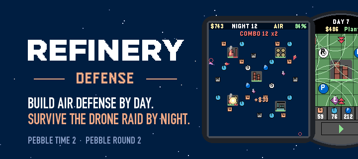
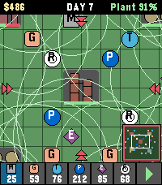
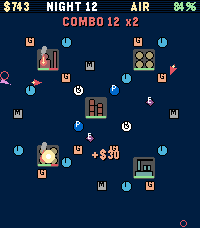
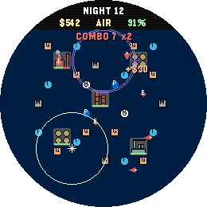

# Refinery Defense



An endless tower defense game for touchscreen Pebble watches. By day you build air defense around an
oil refinery; by night you watch the drone raid come in and call in air strikes, EW pulses and
flares. Survive as many nights as you can.

- **Day:** build from six kinds of units — MG nests, Gepards, Tor and Patriot missile launchers, EW
  jammers and radars. Repair, rebuild and expand the refinery; each outlying object grants a bonus
  while it stands.
- **Night:** five drone types arrive from the map edges in growing waves — swarming Switchblades,
  Shahed-136 and Shahed-238, radar-hunting Harpies and Gerbera decoys. Only what your radars and guns
  can see is drawn on the dark sky.
- **Three difficulties**, separate records, and an optional online leaderboard.
- Built to be played without sound: every event has a visual cue, vibration is optional.

<p>
  
  
  
</p>

## Platforms

| Watch | Platform | Screen |
|---|---|---|
| Pebble Time 2 | `emery` | 200×228, touch |
| Pebble Round 2 | `gabbro` | 260×260 round, touch |

The game needs a touchscreen and asks you to enable touch if it is turned off.

## Controls

| | Day | Night |
|---|---|---|
| Tap | place a unit (second tap buys), open an object or unit | aim an ability, tap again to fire |
| Swipe | scroll the map | — |
| Up / Down | choose unit type | choose ability |
| Select | start the night (press twice) | ×2 speed |
| Back | save and exit to menu | pause |

**Settings → How to play** in the game explains the rules in a few pages. The full reference with
all numbers is in [docs/MECHANICS.md](docs/MECHANICS.md).

## Building

Requires the Pebble SDK (the `pebble` command-line tool).

```bash
pebble build
```

The bundle is written to `build/`; a copy named `build/refinery-defense-<version>.pbw` is kept next
to it. Install it with `pebble install --phone <ip>` or open it in the Pebble app.

## Tests

The game logic in `src/c/logic` is plain C with no Pebble dependencies and is tested on the host,
together with the phone-side JavaScript:

```bash
make -C tests test
```

`make -C tests bench` runs a performance benchmark of the simulation. The balance test plays many
seeds with a bot and checks the difficulty curve; see "Balance check" in
[docs/MECHANICS.md](docs/MECHANICS.md).

## Online leaderboard

Scores are submitted to [LootLocker](https://lootlocker.com) from the phone. The game works fully
offline; the leaderboard is only contacted when you open Leaders or submit a record. The LootLocker
key is not in the repository: a fresh clone builds with the leaderboard off. To connect your own
LootLocker game, follow [docs/LEADERBOARD_SETUP.md](docs/LEADERBOARD_SETUP.md).

## Project layout

```
src/c/logic/   game simulation: board, drones, waves, combat, economy, save format
src/c/app/     Pebble UI: windows, rendering, input, storage, settings
src/pkjs/      phone-side JavaScript: LootLocker client
tests/         host tests for the logic and the JavaScript
docs/          mechanics reference and leaderboard setup
store/         app store banner, icons and screenshots
```

## Versioning

The version lives in `version` in [package.json](package.json), formatted `MAJOR.MINOR.PATCH`.
It is shown at the bottom of the Settings screen and in the bundle name. Fixes bump `PATCH`, new
features bump `MINOR`, breaking save changes or a major redesign bump `MAJOR`. Releases are tagged
`v<version>`, e.g. `v1.4.1`. Keep `gameVersion` in `src/pkjs/lootlocker_config.js` in step.

## License

[MIT](LICENSE)
